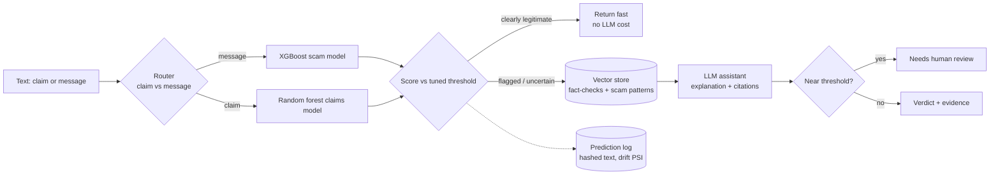
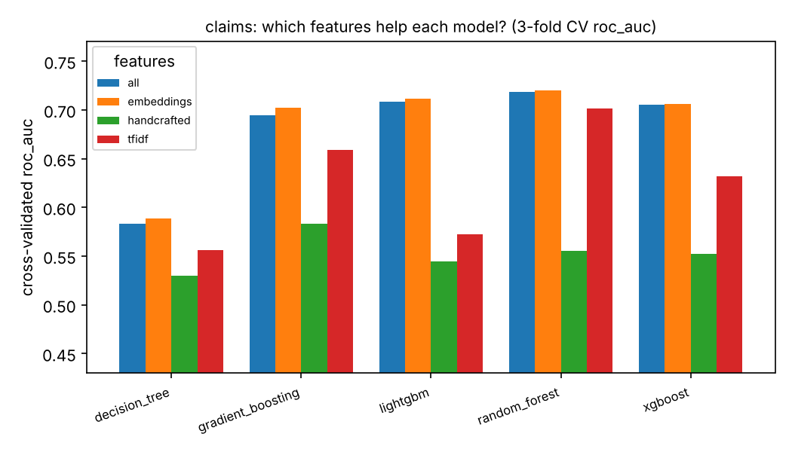
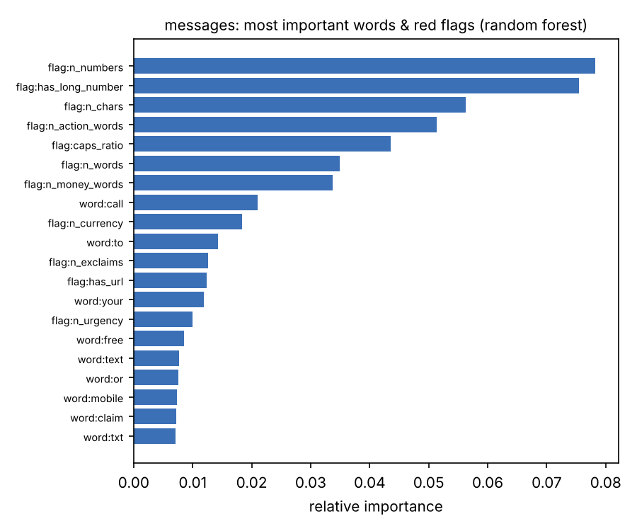

# Financial Misinformation & Scam Detector

**Tree-based machine learning + LLM retrieval-augmented fact-checking to protect people from deceptive financial content.**

A machine learning system that detects **financial misinformation** (false claims
about money, markets, taxes and banks) and **financial scams** (phishing, prize and
investment-fraud messages). It applies the classification techniques from
HarvardX's *Machine Learning and AI with Python* (**decision trees, random
forests and boosting**) and extends them with **LLM embeddings** and a
**retrieval-augmented (RAG) LLM assistant** that explains every flag with cited
evidence.



---

## Results

### Scam messages: 5,160 SMS, 12% scams (test n = 1,032)

| Model | Features | F1 | Precision | Recall | ROC-AUC |
|---|---|---|---|---|---|
| **XGBoost** (selected, tuned threshold 0.37) | words + red flags + embeddings | **0.972** | 0.992 | 0.953 | 0.999 |
| LightGBM | words + red flags + embeddings | 0.964 | 0.992 | 0.938 | 0.999 |
| Gradient boosting | words + red flags + embeddings | 0.964 | 0.984 | 0.945 | 0.999 |
| Random forest | red flags | 0.956 | 0.983 | 0.930 | 0.992 |
| Decision tree | red flags | 0.945 | 0.952 | 0.938 | 0.965 |
| *Always "legit" baseline* | – | 0.000 | – | 0.000 | 0.500 |

(Rows other than XGBoost are at the default 0.5 threshold.)

### Financial claims: 2,033 Snopes fact-checks, 71% false (test n = 407)

| Model | Features | ROC-AUC | Balanced acc. |
|---|---|---|---|
| **Random forest** (selected) | embeddings | **0.664** | 0.616 (threshold 0.69) |
| LightGBM | embeddings | 0.670 | 0.601 |
| XGBoost | embeddings | 0.662 | 0.596 |
| Gradient boosting | embeddings | 0.658 | 0.593 |
| Decision tree | embeddings | 0.586 | 0.590 |
| *Retrieval only (copy verdict of 10 nearest fact-checks)* | – | 0.645 | 0.587 |
| *Always "false" baseline* | – | 0.500 | 0.500 |

<p>


</p>

### What I learned

1. **Boosting wins on scams; random forests win on claims.** XGBoost, LightGBM
   and gradient boosting are nearly tied on scams. For claims, the forest's
   averaging handles noisy labels best. A single decision tree trails everywhere,
   but its readable rules ([messages](reports/messages_decision_tree_rules.txt))
   make it the best tool for *explaining* what scams look like.
2. **Embeddings help most where meaning matters.** For claims, switching from word counts to embeddings raised
   LightGBM's cross-validated ROC-AUC from 0.57 to 0.71. For scams, hand-built red flags
   (long numbers, call-to-action words, CAPS) beat embeddings, because scams
   give themselves away by *form* more than meaning.
3. **A high score can be a shortcut.** On the full Fin-Fact dataset, a rule that
   only looks at *which website* published a claim scored F1 0.818, matching
   the real models. Wording identifies the fact-checker with 94.9% accuracy.
   I retrained on one fact-checker and switched to ROC-AUC
   ([details](docs/HOW_IT_WAS_BUILT.md#the-shortcut-found-during-development-a-governance-lesson)).
4. **Wording alone can't verify a claim.** The claims model is only modestly better than chance,
   which is the motivation for the RAG assistant: truth needs *evidence*, not style.

---

## How the project maps to an AI engineering role

| Skill | Where it is |
|---|---|
| Classification with decision trees, random forests, boosting | [`models.py`](src/fmd/models.py), [`train.py`](src/fmd/train.py) |
| LLM embeddings, vector search, RAG | [`features.py`](src/fmd/features.py), [`rag.py`](src/fmd/rag.py) |
| Prompt engineering, multi-provider LLM (Ollama / OpenAI / Claude) | [`llm.py`](src/fmd/llm.py) |
| Intelligent workflow (cheap model → LLM only when needed → human review) | [`detector.py`](src/fmd/detector.py) |
| Model evaluation (CV, tuning, baselines, slices, threshold tuning) | [`evaluate.py`](src/fmd/evaluate.py), [`reports/`](reports) |
| Governance & responsible AI | [`MODEL_CARD.md`](docs/MODEL_CARD.md), [`check_shortcut.py`](scripts/check_shortcut.py) |
| Observability (hashed logging, PSI drift, latency, LLM error rate) | [`monitor.py`](src/fmd/monitor.py) |
| APIs & deployment | [`api/app.py`](api/app.py) (FastAPI), [`Dockerfile`](Dockerfile), [CI](.github/workflows/ci.yml) |
| Testing | [`tests/`](tests) (19 tests: features, RAG, prompt-injection guard, LLM fallback, drift, API) |

---

## Quick start

```bash
git clone https://github.com/nsenthil07/financial-misinformation-detector.git
cd financial-misinformation-detector
python -m venv .venv && source .venv/bin/activate      # Windows: .venv\Scripts\activate
pip install -r requirements.txt

python scripts/download_data.py                         # Fin-Fact + UCI SMS Spam
PYTHONPATH=src python -m fmd.train                      # ~15-25 min; add --quick for ~5 min
pytest -q                                               # 19 tests

uvicorn api.app:app --reload                            # API docs at http://localhost:8000/docs
streamlit run app/streamlit_app.py                      # clickable demo
```

On Windows PowerShell use `$env:PYTHONPATH="src"` before the train command.

### Turn on the LLM (optional, free)
Everything works without an LLM (a clearly labeled template writes the
explanation). For real LLM explanations:

```bash
# free and local
#   install Ollama from https://ollama.com, then:
ollama pull llama3.2
export FMD_LLM_PROVIDER=ollama

# or a hosted API
export ANTHROPIC_API_KEY=...   # or OPENAI_API_KEY=...
```

Then benchmark it against the tree model:
`python scripts/evaluate_llm.py --task claims --n 100`

### Neural embeddings (optional)
`pip install sentence-transformers` and retrain with
`--embeddings sentence-transformer` to use all-MiniLM-L6-v2 instead of LSA.

### Example API call
```bash
curl -X POST localhost:8000/v1/analyze -H "Content-Type: application/json" \
  -d '{"text": "URGENT: your credit union account is suspended. Verify at www.secure-cu-verify.com"}'
```
```json
{
  "task": "messages", "label": "deceptive", "score": 0.9993, "threshold": 0.37,
  "needs_human_review": false, "model": "xgboost",
  "red_flags": ["contains a link", "urgent / time-pressure language", "mentions your account, card or security", "..."],
  "assistant": {"verdict": "deceptive", "explanation": "...", "citations": [1],
                "recommended_action": "Financial institutions do not ask you to log in through a texted link..."},
  "evidence": [{"id": 1, "text": "Message claims to be from your bank or credit union...", "similarity": 0.754,
                "url": "https://consumer.ftc.gov/articles/how-recognize-and-avoid-phishing-scams"}]
}
```

---

## Project structure
```
src/fmd/
  config.py      settings (paths, seed, thresholds)
  data.py        load + clean Fin-Fact and SMS Spam
  features.py    TF-IDF, red-flag features, embeddings
  models.py      decision tree, random forest, gradient boosting, XGBoost, LightGBM
  train.py       CV feature experiment -> tuning -> test -> threshold -> reports
  evaluate.py    metrics, slices, plots, tree rules
  rag.py         vector store (retrieval)
  llm.py         prompt, providers, JSON parsing, fallback
  detector.py    two-stage workflow + router
  monitor.py     prediction logging + PSI drift
api/app.py       FastAPI service
app/             Streamlit demo
scripts/         data download, shortcut check, LLM benchmark, results table
docs/            HOW_IT_WAS_BUILT.md (step-by-step guide), MODEL_CARD.md
reports/         metrics JSON, figures, decision-tree rules
```

## Limitations
The SMS data is from 2011 UK/Singapore networks and under-represents modern US
scams. The claims model is weak on its own. The published results use LSA
embeddings, and the LLM layer has not yet been benchmarked. See the
[model card](docs/MODEL_CARD.md) for the full list. **This is a research
prototype, not a production fraud system or financial advice.**

## Data & credits
* **Fin-Fact**: Rangapur, A., Wang, H., Jian, L., & Shu, K. (2023). *Fin-Fact: A Benchmark Dataset for Multimodal Financial Fact Checking and Explanation Generation.* arXiv:2309.08793. MIT license.
* **SMS Spam Collection**: Almeida, T. A., & Gómez Hidalgo, J. M. (2011). UCI Machine Learning Repository. CC BY 4.0.
* Scam patterns summarize public consumer guidance from the U.S. Federal Trade Commission (consumer.ftc.gov).
* Course foundation: HarvardX, *Machine Learning and AI with Python*.
